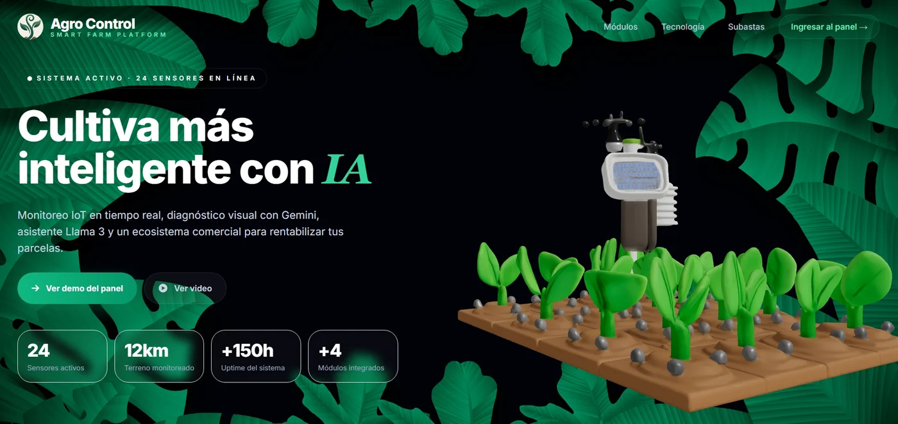
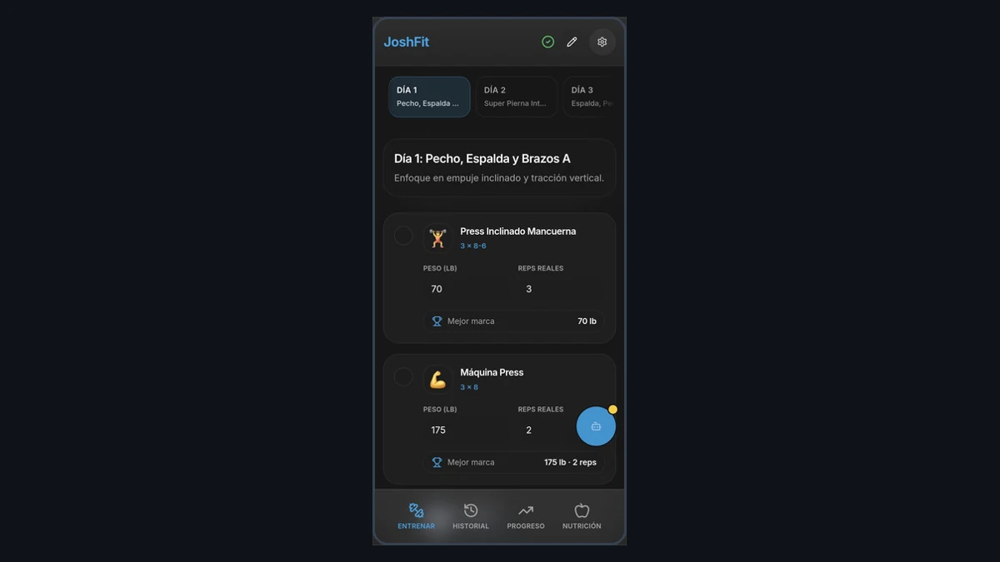
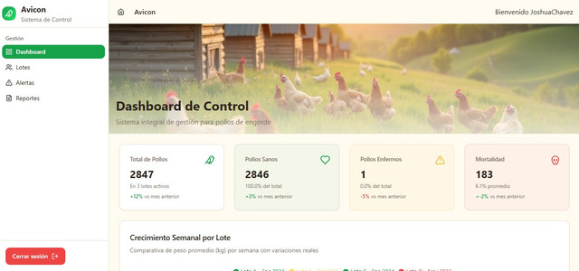

# Joshua Chávez | developer

Ingeniero en Sistemas orientado a la creación de productos de software de extremo a extremo. Me especializo en diseñar arquitecturas escalables, sistemas de gestión empresarial (ERP) e interfaces de usuario de alto rendimiento.

Mi enfoque trasciende la simple escritura de código: busco resolver problemas de negocio reales, optimizar procesos operativos y garantizar la calidad técnica en cada etapa del desarrollo y despliegue.

### Experiencia y Proyectos Arquitectónicos

* **ERP Multi-Sucursal (Insumos Barrera):** Diseño e implementación de una PWA para centralizar las operaciones de dos sucursales, con acceso por roles y resiliencia offline. Despliegue en VPS y servidor físico de respaldo para mejorar la continuidad operativa.
  * *Stack:* React, TypeScript, PWA, Node.js, SQLite, VPS.
* **Herramientas de Administración de Bases de Datos:** Desarrollo de un panel de control personalizado sobre la API de Turso para la gestión integral de planes de usuarios, límites de almacenamiento y aprovisionamiento de claves API.
* **Optimización SEO Técnica (Sector Legal):** Reestructuración de arquitectura web, implementación de enrutamiento basado en slugs dinámicos y esquemas de datos estructurados (*LocalBusiness*) para mejorar la indexación y adquisición de clientes.

## Proyectos Destacados

Casos seleccionados por su impacto funcional, integración de IA y uso en producción.

### 01 · AgroSystem — Agricultura inteligente

  

Integra monitoreo IoT de parcelas, análisis de imágenes con Gemini 2.5 para sugerir posibles enfermedades y un chatbot Llama 3.3 para consultas sobre cultivos. Las sugerencias visuales son orientativas.

**Tecnologías:** `IoT` · `Gemini 2.5` · `Llama 3.3`

 

### 02 · JoshFit — Entrenamiento con IA

  

Reconoce alimentos en fotos y estima sus calorías con Gemini 2.5. Llama 3.3 30B ofrece sugerencias y rutinas como entrenador conversacional; las estimaciones nutricionales son aproximadas.

**Tecnologías:** `Gemini 2.5` · `Llama 3.3 30B` · `Visión por IA`

### 03 · Hotel Mi Bohío — Web y reservaciones

  

Sitio web para un hotel boutique con catálogo de servicios y flujo de reservaciones, diseñado para presentar su oferta y facilitar el contacto con clientes.

**Tecnologías:** `React` · `Vite` · `PHP 8`

### 04 · Avicon System — Gestión avícola

  

Panel de control para el seguimiento de lotes, salud de las aves, mortalidad y producción, con indicadores y reportes para apoyar la operación diaria.

**Tecnologías:** `TypeScript` · `Node.js` · `SQL`

###  Stack Tecnológico y Herramientas

* **Lenguajes Principales:** TypeScript / JavaScript, Python, C#, C++.
* **Frontend:** React, Tailwind CSS, Vite.
* **Backend & APIs:** Node.js, FastAPI, Arquitectura RESTful.
* **Bases de Datos:** PostgreSQL, SQL Server, MongoDB, Turso (SQLite en el borde), Firebase.
* **Infraestructura & Despliegue:** Vercel, Hostinger VPS, Git/GitHub.
* **IA Aplicada:** OpenAI GPT-4 (asistente del portafolio), Gemini 2.5 (análisis de imágenes) y Llama 3.3 / 30B (chatbots), guiados por prompts de sistema.
* **Asistencia al Desarrollo:** OpenCode.

  

### Métricas de Desarrollo

  

 

  
  
  
  
  

---

  <b>📍 Nicaragua</b> | 🔗 <b><a href="https://joshuachavez.vercel.app/">Portafolio Web</a></b> | 💼 <b><a href="https://www.linkedin.com/in/joshua-ch%C3%A1vez-lau-44a65534b/">LinkedIn</a></b>

